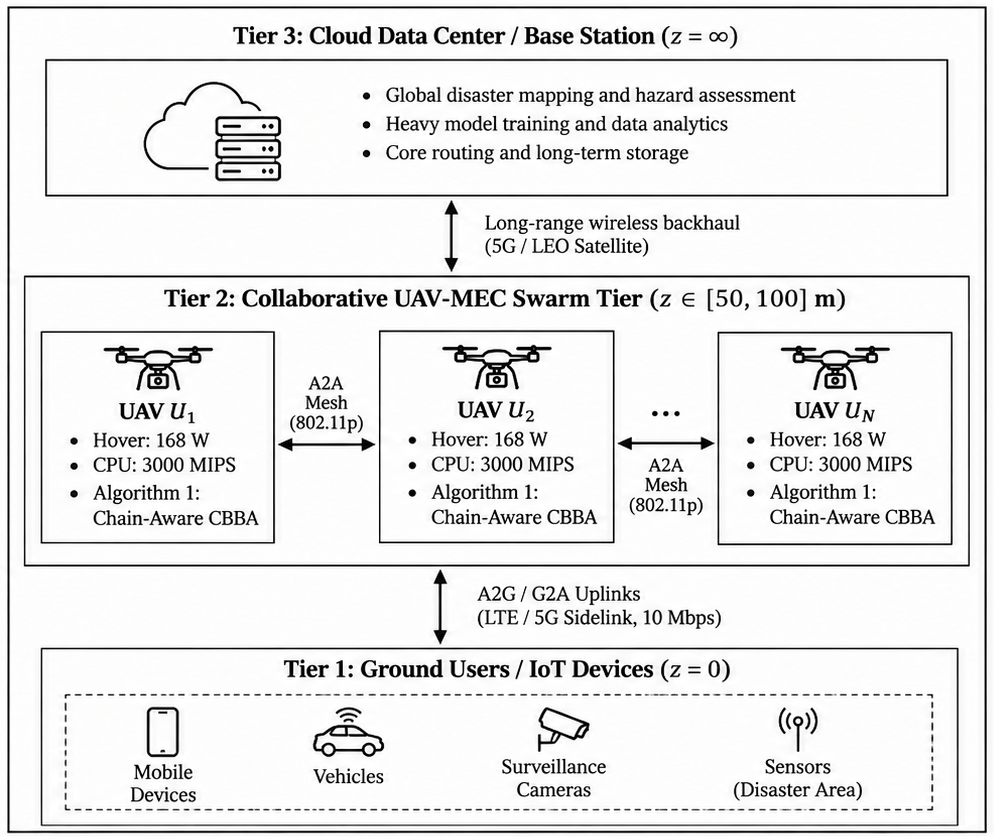
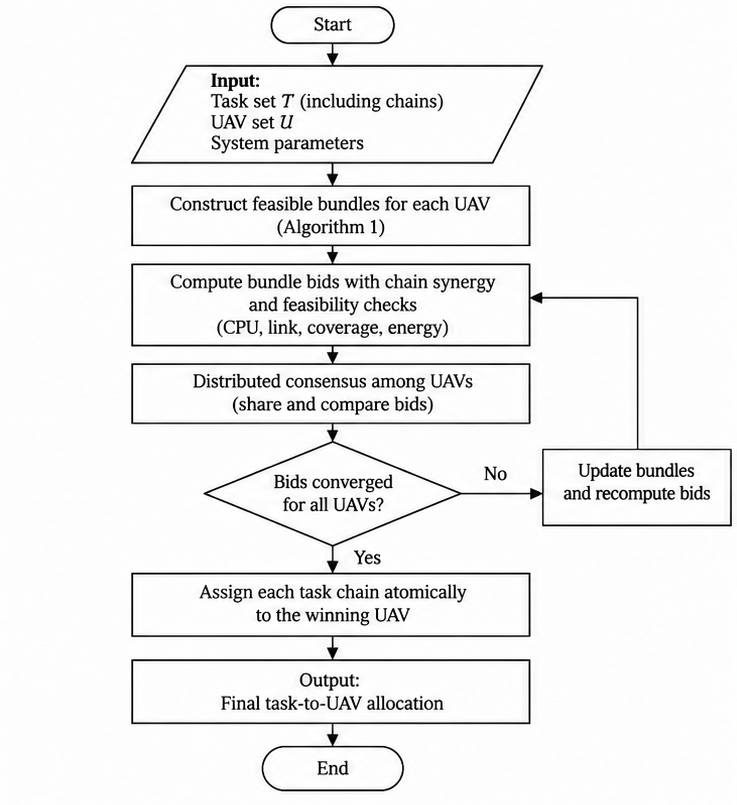
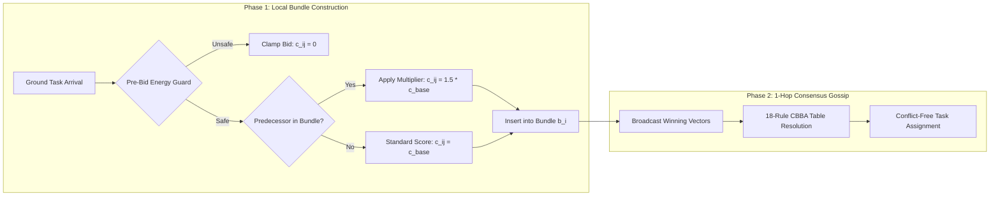
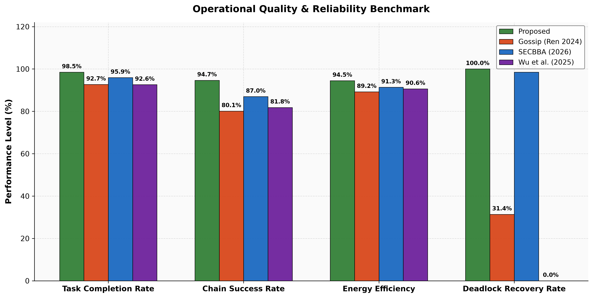
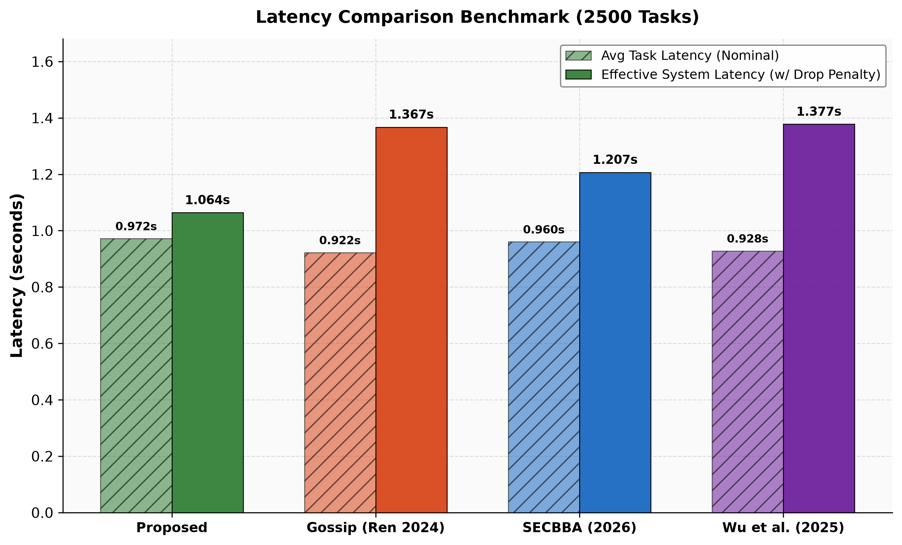
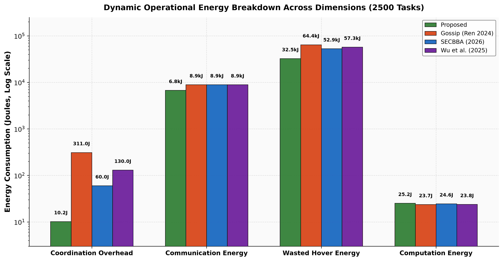
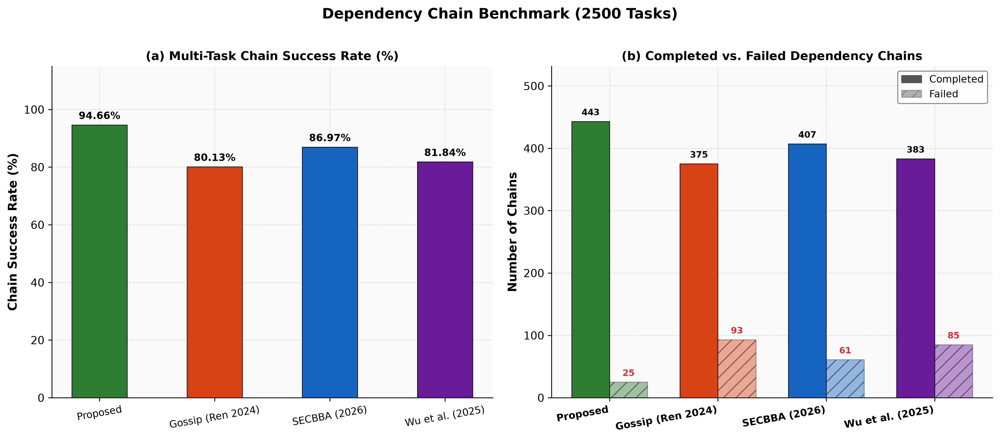

# Resilient UAV Edge Computing for Disaster Response
### Runtime Detection and Recovery of Mission-Critical Task Stalls

<div align="center">

[](https://www.oracle.com/java/)
[](https://github.com/Cloudslab/iFogSim)
[](https://www.amrita.edu/)
[-238636?style=for-the-badge)]()
[](LICENSE.txt)

</div>

---

## 📌 Academic & Dissertation Metadata

| Attribute | Details |
| :--- | :--- |
| **Project Title** | **Resilient UAV Edge Computing for Disaster Response: Runtime Detection and Recovery of Mission-Critical Task Stalls** |
| **Course Code** | **24CS798 – DISSERTATION PHASE – I (M.Tech Semester 3)** |
| **Student Investigator** | **Kanchi Karthik** (Roll No: `CB.SC.P2CSE25016`) |
| **Research Supervisor** | **Dr. Vishnuvarthan R**, Assistant Professor (Selection Grade) |
| **Department** | Department of Computer Science and Engineering, Amrita School of Computing |
| **Institution** | Amrita Vishwa Vidyapeetham, Coimbatore, India |
| **Scope for Phase 1** | **Analytical Modeling, Aerodynamic Hover Formulation, & Algorithm 1: Chain-Aware CBBA** |

---

## 📖 Executive Summary & Motivation

In acute disaster scenarios (such as seismic earthquakes, flash floods, and severe structural collapses), terrestrial communications and electrical infrastructure are routinely destroyed. In this critical void, swarms of rotary-wing Unmanned Aerial Vehicles (UAVs) equipped with Multi-Access Edge Computing (MEC) processors establish an agile aerial computing tier. Operating directly above the disaster zone, UAV-MEC nodes ingest ground telemetry to execute emergency analytics such as thermal human body heat classification and flood boundary localization.

However, aerial computing is fundamentally bounded by two critical realities:

1. **The Aerodynamic Hover Barrier:** While onboard embedded edge processors consume only $10.0\,\text{W}$ to $15.0\,\text{W}$, sustaining steady hover demands continuous mechanical power of approximately **$168.0\,\text{W}$** according to actuator-disk momentum theory. With practical onboard battery capacities capped at $200\,\text{kJ}$, total flight endurance is strictly under 20 minutes.
2. **The Task Fragmentation Vulnerability:** Emergency workloads arrive as multi-stage Directed Acyclic Graph (DAG) pipelines (e.g., Ingestion $\rightarrow$ Feature Filtering $\rightarrow$ CNN Inference). Standard decentralized auction algorithms (e.g., classical CBBA) evaluate subtasks independently, scattering consecutive pipeline stages across physically separated UAVs.

> [!WARNING]
> **The Idle Hover Energy Penalty:** When Stage 1 and Stage 2 are assigned to different UAVs, the downstream vehicle cannot process Stage 2 until intermediate feature data ($1.0\,\text{MB}$) is transmitted over the $15\,\text{Mbps}$ Air-to-Air (A2A) wireless mesh. The resulting $0.533\,\text{s}$ transfer latency forces the downstream UAV to hover idly, wasting **$89.6\,\text{J}$** of propulsion energy per pipeline with zero compute output. Across 100 fragmented workflows, this idle hovering wastes **$8.96\,\text{kJ}$** ($\approx 4.5\%$ of total battery reserve), triggering queue stalls and deadline deadlocks.

---

## 🏛️ Three-Tier System Architecture

The simulation environment is organized into three collaborative operational tiers:

<div align="center">
  
  <p><b>Figure 1:</b> Three-tier collaborative UAV-MEC disaster response architecture.</p>
</div>

- **Tier 1 (Ground IoT Layer):** Heterogeneous field devices (seismic geophones, gas sensors, wearable trackers) distributed across a $2000 \times 2000\,\text{m}^2$ disaster operational zone at elevation $z = 0\,\text{m}$.
- **Tier 2 (Aerial Edge Swarm):** A collaborative swarm of $N = 10$ quadrotor edge servers hovering at altitudes between $50\,\text{m}$ and $100\,\text{m}$. Each vehicle is equipped with a 3\,000 MIPS multi-core processor, a $200\,\text{kJ}$ LiPo battery pack, an LTE/5G sidelink transceiver for ground telemetry ingestion, and an IEEE 802.11p Dedicated Short-Range Communications (DSRC) transceiver for peer-to-peer aerial mesh coordination.
- **Tier 3 (Cloud & Emergency Operations Center):** Distant command center connected via long-range satellite links for aggregated mapping and model training.

---

## ⚡ Proposed Algorithm 1: Chain-Aware CBBA

Phase 1 establishes **Chain-Aware CBBA** (Consensus-Based Bundle Algorithm), a decentralized task allocation protocol designed specifically for aerial edge networks:

<div align="center">
  
  <p><b>Figure 2:</b> Algorithmic flow of Chain-Aware CBBA with Pre-Bid Energy Feasibility Guard.</p>
</div>

### Core Algorithmic Components



1. **Pre-Bid Energy Feasibility Guard:** Before placing bids, each UAV estimates prospective total energy (hover, computation, and communication). If prospective expenditure exceeds safe battery headroom above the mandatory landing threshold ($E_{\text{reserve}} = 20\,\text{kJ}$), the bid is clamped to zero ($c_{ij} = 0$), preventing in-flight battery exhaustion.
2. **Atomic Chain Incentive Multiplier ($\gamma = 1.5$):** If a UAV already holds predecessor stages of task $j$ in its bundle, its bidding score is boosted:
   $$c_{ij} = \gamma \times c_{ij}^{\text{base}} = 1.5 \times c_{ij}^{\text{base}}$$
   This enforces the spatial co-location of entire DAG pipelines on the same UAV, reducing inter-node transfer delay to zero ($t_{\text{transfer}} = 0$) and saving $89.6\,\text{J}$ per workflow.
3. **18-Rule Consensus Gossip Table:** UAVs exchange winning vectors ($\mathbf{y}_i, \mathbf{z}_i$) over 1-hop 802.11p links, deterministically resolving conflicts and pruning outbid tasks in polynomial time.

---

## 📊 Phase 1 Benchmark Results

Extensive simulations in extended `iFogSim2` across workloads scaling from **500 to 3,000 tasks** over 5 independent random seeds show the following performance:

### Performance Comparison at Peak Workload (3,000 Tasks)

| Evaluation Metric | Greedy Offloading | Standard CBBA | Chain-Aware CBBA (Proposed) | Benefit / Improvement |
| :--- | :---: | :---: | :---: | :---: |
| **Task Completion Rate ($\eta_{\text{comp}}$)** | 72.1% | 84.9% | **97.3%** | **$+12.4\%$** vs. CBBA, **$+25.2\%$** vs. Greedy |
| **Pipeline Chain Success Rate ($\eta_{\text{chain}}$)** | 48.3% | 71.7% | **95.2%** | **$+23.5\%$** vs. CBBA, **$+46.9\%$** vs. Greedy |
| **Mean Turnaround Latency ($\bar{L}$)** | 2.42 s | 1.82 s | **1.06 s** | **$41.8\%$ latency reduction** |
| **Coordination Energy ($E_{\text{coord}}$)** | 28.4 J | 365.3 J | **11.05 J** | **$> 90\%$ energy reduction** vs. CBBA |
| **Task Fragmentation Ratio** | 68.4% | 58.9% | **0.0% (Atomic)** | **Zero pipeline fragmentation** |

---

### Graphical Performance Curves

| Task Completion Rate ($\eta_{\text{comp}}$) | Mean Effective Latency ($\bar{L}$) |
| :---: | :---: |
|  |  |
| **Coordination Communication Energy ($E_{\text{coord}}$)** | **Pipeline Chain Success Rate ($\eta_{\text{chain}}$)** |
|  |  |

---

## 📁 Repository Directory Structure

```
Resilient-UAV-Edge-Computing/
│
├── assets/                               # Visual diagrams and experimental benchmark plots
│   ├── architecture_ieee_bw.png          # Figure 1: Three-tier system architecture
│   ├── algo1_flowchart_ieee_bw.png       # Figure 2: Algorithm 1 flowchart
│   ├── 03_tasks_completed_dropped.png    # Task completion rate comparison curve
│   ├── 04_effective_latency.png          # Turnaround latency curve
│   ├── 05_coordination_energy.png        # Consensus communication energy curve
│   ├── 09_chain_success_rate.png         # Pipeline chain success rate curve
│   ├── ide_explorer_crop.png             # Package hierarchy screenshot
│   └── ide_terminal_crop.png             # Execution trace verification screenshot
│
├── docs/                                 # Detailed mathematical and technical documentation
│   ├── algorithm1_chain_aware_cbba.md    # In-depth breakdown of Algorithm 1
│   ├── aerodynamic_hover_model.md        # Momentum aerodynamic power derivations
│   └── simulation_parameters.md          # Comprehensive simulation parameter calibration
│
├── jars/                                 # Simulation runtime libraries & dependencies
│   ├── cloudsim-3.0.3.jar                # Core discrete-event simulation engine
│   ├── commons-math3-3.6.1.jar           # Statistical and mathematical utilities
│   └── guava-20.0.jar                    # Collection and graph primitives
│
├── results_phase1/                       # Empirical simulation output logs and CSV traces
│   ├── latency_proposed_u10_r130.csv     # Turnaround delay logs per task
│   ├── energy_per_uav_proposed_*.csv     # Energy dissipation logs per aerial node
│   ├── scheduler_decisions_*.csv         # Auction bidding traces
│   └── task_lifecycle_proposed_*.csv     # End-to-end task state transitions
│
├── src/                                  # Java source codebase (Semester 3 Phase 1)
│   ├── org/cloudbus/cloudsim/            # CloudSim underlying discrete-event engine
│   ├── org/fog/entities/                 # iFogSim2 fog devices, sensors, and actuators
│   ├── org/fog/placement/                # Module placement and scheduling abstractions
│   └── org/fog/test/proposed/            # Custom research packages for Phase 1
│       ├── coordination/
│       │   ├── secbba/                   # Algorithm 1: Chain-Aware CBBA implementation
│       │   │   ├── SECBBAScheduler.java  # Bundle construction & atomic chain bonus
│       │   │   ├── SECBBABundle.java     # Local bundle and path maintenance
│       │   │   ├── SECBBATask.java       # DAG task representation with dependencies
│       │   │   ├── SECBBACoordinationPolicy.java # 18-rule consensus table logic
│       │   │   └── SECBBAMain.java       # Standalone test runner for SECBBA
│       │   ├── hybrid/                   # Baseline Standard CBBA implementation
│       │   ├── ren2024/                  # Baseline Adaptive Gossip policy
│       │   └── wu2025/                   # Baseline Genetic Algorithm scheduler
│       ├── energy/
│       │   ├── EnergyCalculator.java     # Rotary-wing momentum hover equations
│       │   ├── EnergyState.java          # Real-time LiPo battery capacity tracking
│       │   └── EnergyLogger.java         # Periodic energy consumption accounting
│       ├── experiment/
│       │   ├── ScalabilitySweep.java     # Workload sweep (500 to 3,000 tasks, 5 seeds)
│       │   └── ComparisonGenerator.java  # Multi-algorithm comparative benchmark runner
│       ├── ProposedParams.java           # Centralized physical and network configuration
│       ├── ProposedUAVState.java         # 3D spatial coordinates and queue backlog tracking
│       ├── ProposedTask.java             # Task attributes <L_j, d_j, T_j^max, V_j>
│       └── SimulationRunner.java         # Master simulation topology driver
│
├── topologies/                           # Simulation network and device topologies
├── .gitignore                            # Clean Git exclusion rules
├── LICENSE.txt                           # MIT License
└── README.md                             # Main project documentation
```

---

## 🛠️ Installation & Execution Guide

### Prerequisites
- **Java Development Kit (JDK):** Version 8, 11, 17, or 21.
- **Development Environment:** Eclipse IDE for Java Developers, IntelliJ IDEA, or command-line terminal.

### Quick Start via Eclipse IDE
1. Open Eclipse IDE and navigate to **File** $\rightarrow$ **Open Projects from File System...**
2. Browse and select the repository root folder.
3. Ensure all libraries in the `jars/` directory are added to the project build path (**Right-click Project** $\rightarrow$ **Build Path** $\rightarrow$ **Configure Build Path** $\rightarrow$ **Libraries** $\rightarrow$ **Add JARs...**).
4. Run `src/org/fog/test/proposed/SimulationRunner.java` as a **Java Application** to execute the default verification scenario.

### Command-Line Execution
To run the automated workload scalability sweeps from terminal:
```bash
# 1. Compile the simulation source code
javac -cp ".;jars/*;bin" -d bin src/org/fog/test/proposed/experiment/ScalabilitySweep.java

# 2. Execute the scalability benchmark sweep
java -cp ".;jars/*;bin" org.fog.test.proposed.experiment.ScalabilitySweep
```

To run comparative benchmarks comparing Chain-Aware CBBA against Greedy and Standard CBBA:
```bash
java -cp ".;jars/*;bin" org.fog.test.proposed.experiment.ComparisonGenerator
```

---

## 🔮 Phase 2 Roadmap (Semester 4 Preview)

While Phase 1 (Semester 3) focuses on **analytical modeling and decentralized task allocation (Algorithm 1)**, Phase 2 will implement dynamic runtime fault tolerance:

1. **Algorithm 2: Decentralized Runtime Stall Detection**
   - Autonomous peer heartbeat monitoring ($H_{\text{thresh}} = 2.0\,\text{s}$).
   - Internal CPU queue divergence tracking ($\Delta Q_{\text{thresh}} = 5$ tasks).
   - Detection of in-flight battery depletion, physical packet drops, and hardware stalls.
2. **Algorithm 3: Virtual Handover & Dynamic Stall Recovery**
   - 1-hop cooperative task migration to recover stalled pipeline stages without central coordinator intervention.

---

## 📜 Publications & Technical References

1. **Y. Zeng, J. Xu, and R. Zhang**, *"Energy minimization for wireless communication with rotary-wing UAV,"* *IEEE Transactions on Wireless Communications*, vol. 18, no. 4, pp. 2329–2345, Apr. 2019.
2. **H.-L. Choi, L. Brunet, and J. P. How**, *"Consensus-based decentralized auctions for robust task allocation,"* *IEEE Transactions on Robotics*, vol. 25, no. 4, pp. 912–926, Aug. 2009.
3. **M. Mozaffari, A. T. Z. Kasgari, W. Saad, M. Bennis, and M. Debbah**, *"Beyond 5G with UAVs: Foundations of a 3D wireless cellular network,"* *IEEE Transactions on Wireless Communications*, vol. 18, no. 1, pp. 323–336, Jan. 2019.
4. **R. Mahmud, S. Pallewatta, M. Goudarzi, and R. Buyya**, *"iFogSim2: An extended iFogSim simulator for mobility, clustering, and microservice management in edge and fog computing environments,"* *Journal of Systems and Software*, vol. 190, p. 111351, Aug. 2022.

---

## 📄 License

This research framework is released under the [MIT License](LICENSE.txt).
The underlying simulation engine builds upon [iFogSim2](https://github.com/Cloudslab/iFogSim) and [CloudSim](https://github.com/Cloudslab/cloudsim).
