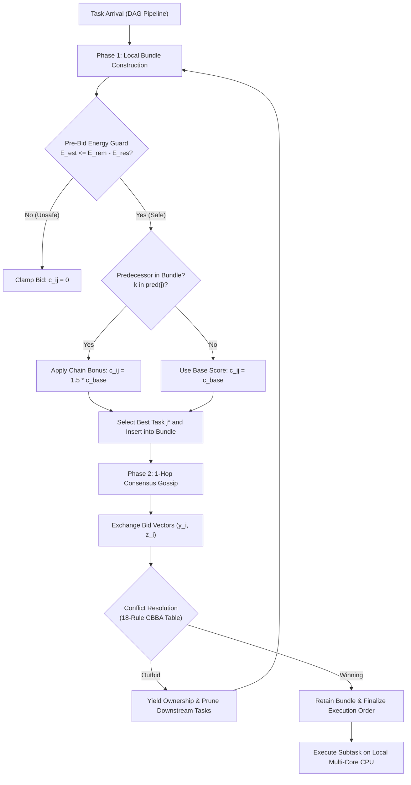

# Algorithm 1: Chain-Aware Consensus-Based Bundle Algorithm (CBBA)

This document provides a comprehensive technical breakdown of **Chain-Aware CBBA**, the decentralized task allocation protocol developed for Phase 1 of the M.Tech dissertation.

---

## 1. Operational Motivation & Problem Definition

In aerial edge computing swarms deployed over disaster areas, computational workloads generated by ground Internet of Things (IoT) sensors arrive as multi-stage Directed Acyclic Graph (DAG) pipelines (e.g., Image Framing $\rightarrow$ Feature Filtering $\rightarrow$ CNN Victim Classification).

Classical decentralized auction algorithms (such as standard CBBA) treat each pipeline stage as an isolated, independent task. Consequently:
- Stage 1 is frequently awarded to UAV $\mathcal{U}_1$.
- Stage 2 is awarded to UAV $\mathcal{U}_2$.

This spatial separation triggers **Task Fragmentation**. UAV $\mathcal{U}_2$ cannot begin executing Stage 2 until the intermediate feature data is transmitted over the lossy wireless Air-to-Air (A2A) mesh network. Because rotary-wing UAVs consume roughly **$168.0\,\text{W}$** merely sustaining steady hover, waiting idly for wireless transmissions drains substantial battery reserves ($89.6\,\text{J}$ per pipeline) without producing any computational progress.

---

## 2. Core Algorithmic Mechanics

Chain-Aware CBBA eliminates task fragmentation through two integrated mechanisms:

### 2.1 Pre-Bid Energy Feasibility Guard
Before any UAV $\mathcal{U}_i$ computes a bid for candidate task $j$, it calculates the prospective energy requirement across hover, computation, and wireless reception:
$$E_{\text{est}}(j, i) = P_{\text{hover}}(t_{\text{comp}} + t_{\text{ingest}}) + P_{\text{cpu}} t_{\text{comp}} + P_{\text{comm}} t_{\text{ingest}}$$

The estimated requirement is compared against the remaining battery capacity above a mandatory reserve threshold ($E_{\text{reserve}} = 20\,\text{kJ}$):
$$E_{\text{est}}(j, i) > E_{\text{rem}, i} - E_{\text{reserve}} \implies c_{ij} = 0$$

If the energy constraint is violated, the bid is clamped to zero, preventing energy-compromised UAVs from accepting tasks that would cause in-flight power exhaustion.

### 2.2 Atomic Chain Incentive Multiplier ($\gamma = 1.5$)
If the energy guard passes, the baseline marginal score $c_{ij}^{\text{base}}$ is calculated based on Diminishing Marginal Gain (DMG):
$$c_{ij}^{\text{base}} = \delta_j^{\tau_i} \left[ V_j - \beta \cdot T_j^{\text{exec}}(i) \right]$$

To actively encourage pipeline co-location, the algorithm checks whether UAV $\mathcal{U}_i$'s current bundle $\mathbf{b}_i$ already contains an immediate predecessor of task $j$:
$$c_{ij} = \begin{cases} \gamma \times c_{ij}^{\text{base}} = 1.5 \times c_{ij}^{\text{base}}, & \text{if } \exists k \in \mathbf{b}_i \text{ such that } k \in \text{pred}(j) \\ c_{ij}^{\text{base}}, & \text{otherwise} \end{cases}$$

This dynamic boost ensures that nodes already executing predecessor stages win successor stages, co-locating the entire pipeline in local memory and reducing Air-to-Air transfer latency to zero ($t_{\text{transfer}} = 0$).

---

## 3. Two-Phase Protocol Lifecycle

---

## 4. Algorithmic Complexity

- **Local Bundle Evaluation:** $\mathcal{O}(|\mathcal{T}| \cdot B_{\max}^2)$, where $|\mathcal{T}|$ is the candidate task count and $B_{\max}$ is the maximum bundle size.
- **Consensus Message Exchanges:** $\mathcal{O}(N \cdot D_{\text{mesh}})$, where $N$ is swarm size and $D_{\text{mesh}}$ is the network diameter.
- **Convergence Time:** Proven to reach a conflict-free allocation in under $100\,\text{ms}$ over standard $15\,\text{Mbps}$ 802.11p DSRC wireless channels.
